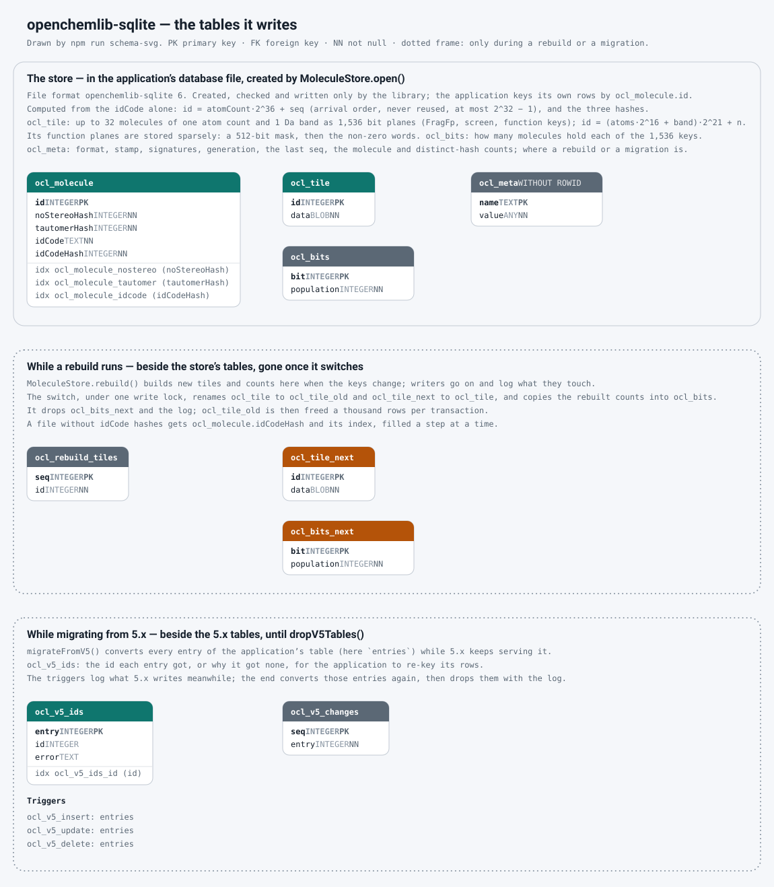

# openchemlib-sqlite

[](https://www.npmjs.com/package/openchemlib-sqlite)
[](https://github.com/cheminfo/openchemlib-sqlite/actions/workflows/nodejs.yml)

The storage and the in-memory search engine of a molecule database, in the application's own
SQLite file. Substructure, similarity and browse are answered in pages with a cursor, lightest
first by the application's order key, every page by its deadline. Everything the library stores is
computed by it from the idCode alone, through
[openchemlib-search-wasm](https://github.com/cheminfo/openchemlib-search-wasm).

Two exports:

- `openchemlib-sqlite`: `MoleculeStore`, the write side and the identity of molecules;
- `openchemlib-sqlite/index`: `MoleculeIndex`, the in-memory search engine over the same file.

## Requirements

- Node.js ≥ 22.16 (`node:sqlite`). Use a glibc image (`node:24-slim`), not Alpine: musl's
  allocator serializes multi-threaded reads.
- RAM for the index: about 265 B per molecule, 192 B of them its 1,536 bit planes: about 32 GB for
  120 M molecules.

```sh
npm install openchemlib-sqlite
```

## The file

The library owns four tables and creates them on first use. The application keys its own tables
by the same id and never writes these.



```sql
CREATE TABLE ocl_molecule (
  id INTEGER PRIMARY KEY,         -- atomCount·2^36 + seq: the substructure floor; seq never reused
  noStereoHash INTEGER NOT NULL,  -- hash of the canonical no-stereo idCode
  tautomerHash INTEGER NOT NULL,  -- hash of the no-stereo generic tautomer (cap 5,000), else noStereoHash
  idCode TEXT NOT NULL,           -- canonical idCode
  idCodeHash INTEGER NOT NULL DEFAULT 0 -- strongHash(idCode): the exact structure
);
CREATE INDEX ocl_molecule_nostereo ON ocl_molecule (noStereoHash);
CREATE INDEX ocl_molecule_tautomer ON ocl_molecule (tautomerHash);
CREATE INDEX ocl_molecule_idcode ON ocl_molecule (idCodeHash);
CREATE TABLE ocl_tile (id INTEGER PRIMARY KEY, data BLOB NOT NULL);
CREATE TABLE ocl_meta (name TEXT PRIMARY KEY, value ANY NOT NULL) WITHOUT ROWID;
CREATE TABLE ocl_bits (bit INTEGER PRIMARY KEY, population INTEGER NOT NULL); -- 1,536 rows
```

- **`ocl_tile`** holds the fingerprints once, as bit planes: up to 32 molecules of one cell (an atom
  count and a 1 Da band of OCL's own weight) per record: 1,024 plane words (FragFp 512,
  then the 512-key screen), 32 seqs, 32 FragFp bit counts, the slots used, then the 512 function-key
  planes sparsely: a 512-bit mask of those holding a bit, then their words. A record is 4,356 bytes
  without any function word and 6,404 with all of them; a full tile of the test sample's molecules
  holds about 125 of the 512, 4,860 bytes. Its key is `(atomCount·2^16 + band)·2^21 + tileSeq`. A
  commit rewrites only the open tile of each cell it touches.
- **`ocl_bits`** counts, for each FragFp, screen and function key (rows 0–511, 512–1023 and
  1024–1535, in the order of `getFragFpKeys()`, `getScreenKeys()` and `getFunctionKeyFragments()`),
  how many stored molecules hold it. Every commit adds its new molecules and every removal takes
  them away, in the same transaction: about 2 µs a molecule (commits of 500), against 5.5 ms to
  prepare one. The function words are stored in the tiles, planes 1024–1535.
- **`ocl_meta`** holds `format`, `stamp`, `seq` (the last issued), `count`, `generation`, the
  signatures, and `distinctNoStereo` and `distinctTautomer`: how many distinct identity hashes the
  molecules carry, kept exact by every commit and removal. A file written before they were kept
  gets them counted, once, when a store opens it.
- **The signatures** say what each part was computed under: `signature.identity` (canonical
  idCode, atom count, band, both hashes), `signature.fragFp`, `signature.screen` and
  `signature.functions` (the tiles), `signature.idCodeHash` (the hash of the idCode), and
  `counted.fragFp`, `counted.screen`,
  `counted.functions` (the bit counts). A fingerprint's
  signature digests its key list and its bits for built-in molecules: the keys catch a changed key
  no built-in molecule holds, the bits catch OCL reading the same keys differently.
- **The stamp** digests the identity, FragFp, screen, function-key and idCode-hash signatures:
  everything a file stores. A file written under another stamp is refused, and opening a store recomputes 32
  sampled molecules. What a query is read into is left out: it is never stored, so a release that
  only reads queries better keeps every file.

Use `PRAGMA page_size = 4096` (the default) and WAL.

## MoleculeStore

```js
import { DatabaseSync } from 'node:sqlite';
import { MoleculeStore } from 'openchemlib-sqlite';

const db = new DatabaseSync('data/sqlite/db.sqlite');
const store = await MoleculeStore.open(db, { threads: 8 });

const batch = await store.prepare(idCodes); // worker threads, nothing written
db.exec('BEGIN IMMEDIATE');
const results = store.commit(batch); // inside the caller's transaction
for (const [i, result] of results.entries()) {
  if (result === undefined) continue; // batch.molecules[i].error says why
  if (result.created) insertAppRow(result.id, batch.molecules[i].idCode);
}
db.exec('COMMIT');
```

| Method                                    | What it does                                                                                                                  |
| ----------------------------------------- | ----------------------------------------------------------------------------------------------------------------------------- |
| `MoleculeStore.open(db, options)`         | creates the tables, or refuses a foreign format or stamp; recomputes `checkRows` (32) sampled molecules; `threads`, `readers` |
| `prepare(idCodes)`                        | computes the canonical idCode, atom count, band, FragFp, screen, function keys and the three hashes; per-molecule `error`     |
| `commit(batch)`                           | writes a prepared batch in the caller's transaction; `{ id, created }` per molecule; duplicates get their id back             |
| `find(idCodes)`                           | the id of each stored molecule (canonical or not), or undefined                                                               |
| `prefetch(batch, reads)`                  | the readers read the index pages a commit of the batch writes, and run the application's `reads` once per key                 |
| `stereoisomers(idCode, { after, limit })` | ids with the same no-stereo hash, in id order                                                                                 |
| `tautomers(idCode, { after, limit })`     | ids with the same tautomer hash, in id order                                                                                  |
| `byHashes(kind, hashes)`                  | ids holding each `'idCode'`, `'noStereo'` or `'tautomer'` hash: one indexed seek per hash                                     |
| `keys(ids)`                               | `{ idCode, noStereoHash, tautomerHash, idCodeHash }` by id                                                                    |
| `remove(ids)`                             | administrative clean-up in the caller's transaction: rows deleted, tile slots emptied, seqs never reused                      |
| `count()`, `lastSeq()`                    | from `ocl_meta`                                                                                                               |
| `distinctHashes()`                        | `{ noStereo, tautomer }`: what `count(DISTINCT …)` over `ocl_molecule` answers, from `ocl_meta`                               |
| `bitCounts()`                             | `{ molecules, fragFp, screen, functions }`: per key, how many molecules hold it; null for one counted under other keys        |
| `MoleculeStore.updates(db)`               | what this build would rebuild: `{ identity, tiles, counts, rebuilding }`; writes nothing                                      |
| `MoleculeStore.rebuild(db, options)`      | brings the file to this build while the build that wrote it keeps searching it; see below                                     |
| `MoleculeStore.abandonRebuild(db)`        | stops a rebuild and frees what it built; writes resume                                                                        |
| `close()`                                 | stops the worker threads                                                                                                      |

`commit()` accepts only batches the store itself prepared: no value computed by the caller ever
reaches the library's tables.

A stored molecule is recognized by one seek of the hash of its idCode, the idCode itself telling
apart two that share a hash; whether its compound is stored is one more seek, of its no-stereo hash.
Neither `find()` nor `commit()` reads the stored stereoisomers of a molecule, so their cost does not
grow with them. `find()` computes a canonical idCode only for an idCode it did not find whose
compound is stored: a stereoisomer, or an idCode given in another form.

For a connection that commits many new molecules, `readers: n` takes the reads off its thread: it
starts `n` threads with read-only connections of their own. `find()` makes its seeks there, and
`prefetch()` seeks, ahead of a commit, the pages of the three hash indexes where the batch's
molecules go, so that the commit finds them in the operating system's cache.

### When keys change: rebuild beside, then switch

A new openchemlib-search-wasm may change keys. Its signatures then differ from the file's, and the
library knows which part to compute again:

| Changed                                   | This build                                 | What `MoleculeStore.rebuild()` does                                            |
| ----------------------------------------- | ------------------------------------------ | ------------------------------------------------------------------------------ |
| function keys                             | refuses the file, naming the function keys | computes the function words of every molecule (2.0 ms) and counts them         |
| screen keys                               | refuses the file, naming the screen        | computes the screen of every molecule (0.75 ms) and counts it again            |
| FragFp (OCL)                              | refuses the file, naming FragFp            | computes FragFp, and the screen if it changed too (2.4 ms with both)           |
| idCode hashes, or a file without them     | refuses the file                           | adds the column and its index, and hashes every stored idCode                  |
| canonization or identity hashes           | refuses the file                           | nothing: commit the idCodes into a new file                                    |
| a pre-release 6.0 file (4,292-byte tiles) | refuses it                                 | nothing: commit its idCodes into a new file, or migrate its 5.x original again |

The rebuild runs with the new build, in a process of its own with a connection of its own, while
the build that wrote the file keeps serving it, searches and writes alike:

1. When the idCode hashes are missing, the column and its index are added (building the index
   holds the write lock for as long), and every stored idCode is hashed, 4,096 per short write
   transaction; the hash needs no chemistry. Rows a build without the column commits meanwhile
   get 0, and are hashed at the switch.
2. A first pass writes, beside the tiles in use, new ones into `ocl_tile_next` (the same keys,
   slots and seqs; only the recomputed bits differ, so ids and the application's rows stay valid)
   and the new counts into `ocl_bits_next`, 256 tiles per short write transaction.
3. Meanwhile every `commit()` and `remove()` logs the tiles it changes (`ocl_rebuild_tiles`).
   Catch-up rounds then bring the new tiles up to date from that log: slots are taken in order and
   never reused, so a slot holds the same molecule in both tiles, or it arrived (computed from its
   idCode), or it left (cleared).
4. Once 512 changes or fewer are left, one transaction takes them, under the write lock, hashes
   the molecules committed since the hash pass began, and puts the new tiles in place: the tiles
   in use are renamed `ocl_tile_old`, the new ones take their name, the new counts replace those of
   the rebuilt fingerprints, the file takes the new stamp and signatures, and the generation rises.
   Writes wait for it as for any commit.
5. The replaced tiles are freed a thousand rows per transaction: dropped whole, the tiles of 200 M
   molecules would hold the write lock for 7 s.

Each step commits its progress: interrupted, `rebuild()` resumes where it stopped, and
`MoleculeStore.abandonRebuild(db)` throws its work away instead. After the switch a store opened by
the old build refuses to write ("rebuilt for another build"), and its index stops following the file
but keeps answering from what it loaded, until the new build replaces it. A store of the same build
takes the new generation and goes on. A rebuild that only counts keeps the stamp, so the index
follows the file throughout.

## MoleculeIndex

The index loads the tiles into RAM as bit planes grouped by atom count and band, follows the
commits, and answers pages. The application hands it, as SQL run at load and on each change, its
order key, its filter columns, its id sets and its change log. Caller data only filters and orders:
what can match is decided by the library's fingerprints and atom-count floor.

```js
import { MoleculeIndex } from 'openchemlib-sqlite/index';

const index = await MoleculeIndex.open(
  'data/sqlite/db.sqlite',
  {
    columns: {
      // id, the order key, then one value per filter column, for ids in [:from, :to], ordered by id
      sql: `SELECT m.id, f.mw, m.logP, f.charge FROM molecules m JOIN formulas f ON f.id = m.formulaId
          WHERE m.id BETWEEN :from AND :to ORDER BY m.id`,
      filters: [
        { name: 'logP', type: 'float32' },
        { name: 'charge', type: 'int16' },
      ],
    },
    sets: {
      listed: {
        members:
          'SELECT id FROM molecules WHERE listed = 1 AND id BETWEEN :from AND :to ORDER BY id',
      },
      source: {
        names: 'SELECT id FROM sources WHERE isPublic = 1',
        members: `SELECT moleculeId FROM molecule_sources WHERE sourceId = :set
                AND moleculeId BETWEEN :from AND :to ORDER BY moleculeId`,
      },
    },
    defaultSets: ['listed'],
    changes: {
      read: 'SELECT id, moleculeId FROM entry_changes WHERE id > :after ORDER BY id LIMIT :limit',
      last: "SELECT seq FROM sqlite_sequence WHERE name = 'entry_changes'",
      first: 'SELECT min(id) FROM entry_changes',
    },
  },
  { threads: 6 },
);

const options = {
  limit: 24,
  sets: ['source:3'],
  filters: { logP: { min: 2 } },
  keyMin: 250, // a seek, not a filter
};
const page = await index.substructure(queryIdCode, options);
const next = await index.substructure(queryIdCode, {
  ...options,
  after: page.next,
});
```

| Method                                                | Answers                                                                                                                                       |
| ----------------------------------------------------- | --------------------------------------------------------------------------------------------------------------------------------------------- |
| `MoleculeIndex.open(file, spec, options)`             | loads the image with `readers` threads, or reads back its `snapshot`, then follows the file                                                   |
| `substructure(queryIdCode, options)`                  | `{ hits: [{ id, key }], next, partial, unverified, info }`, by key then id                                                                    |
| `browse(options)`                                     | the same walk without a structure                                                                                                             |
| `count(options)`                                      | `{ total, bySet, byKey, membership, combinations, histogram, complete }`: what a browse with the same options answers, counted in the workers |
| `similarity(idCode, { threshold, fingerprint, ... })` | `{ hits: [{ id, score }], next, total, partial, fingerprint, reason, info }`, by Tanimoto then id                                             |
| `poll()`, `waitForSeq(seq, timeoutMs)`                | catch up now; wait until a seq is searchable, rejecting after `timeoutMs` (60,000)                                                            |
| `version`, `watermark`, `rowCount`, `sets`            | the version searched                                                                                                                          |
| `saveSnapshot()`                                      | saves the index to its `snapshot` now: null, or why it was not                                                                                |
| `tailStats()`, `errors`, `close()`                    |                                                                                                                                               |

Search options: `limit` (24), `sets` (rows of at least one of them; default `defaultSets`, every
alive row without any), `allSets` (rows of every one), `noneSets` (rows of none), `bits` (keys a row
holds or lacks: `{ all, any, none }`), `filters` (inclusive bounds by column), `keyMin` / `keyMax`,
`lane` (`'interactive'`), `budgetMs` (4,500), `signal`, and `after` (the previous page's `next`).
An unknown name in `sets` adds nothing, in `allSets` answers nothing, in `noneSets` removes
nothing. Esters of source 3 that are not lactones:

```js
const page = await index.browse({
  sets: ['source:3'],
  bits: { all: [1300], none: [1304] }, // 1300 is ester, 1304 lactone
});
```

**Key bits.** A key is bit b of the 48-word record `getMoleculeRecords` writes, numbered from the
highest bit of word 0: word `b >> 5`, mask `1 << (31 - (b & 31))`. FragFp keys are 0–511, the screen
512–1023, the function keys 1024–1535 (`getFunctionKeyFragments()` order, the dictionary's
`plane` + 1024). For a function key of the dictionary, `getRecordBit(key)` from
`openchemlib-search-wasm/function-keys` gives `{ word, mask }`, so b is
`32 * word + Math.clz32(mask)`; it gives undefined for a key computed on demand, which no tile
stores. The tiles store every key, so a condition on them is exact: a browse with `bits` is never
verified, and a substructure search verifies its query alone. `all`, `any` and `none` take 256
bits each at most; `any` puts no condition when empty.

**Lanes.** A search waits in one of two queues when the workers are busy: when they free up, the
oldest `'interactive'` search runs before any `'bulk'` one, and a running search is never
interrupted, so the site's own pages come first and agents, counts and exports run in short turns
between them. An interactive page's budget counts from the call, as before; a bulk one's from when
it starts running, so waiting never eats it.

- **Order.** Results come by the order key, then id, exactly. `next` is `{ key, id }`. A partial
  page (the deadline came first) is the exact prefix of the full order, and `next` continues it
  with no gap and no duplicate. `keyMin` and `keyMax` are seeks.
- **Similarity** is ranked by score with a `{ score, id, fingerprint }` cursor. A complete page
  holds the exact best hits after the cursor and the exact `total`; a partial one holds the best of
  the atom counts read (nearest the query's first) and no `next`. `info.scored` counts the rows
  whose Tanimoto was computed (inside the bit-count window and the filters): at least `total`.
- **Fingerprints.** Each similarity search chooses what it scores: `fingerprint: 'fragFp'`
  (OCL's 512 FragFp keys, the default, so scores are FragFp Tanimoto as before),
  `'screen'` (the 512 query-fragment keys) or `'both'` (1,024 bits). The index keeps each row's
  FragFp and screen bit counts (`both` is their sum) and a bit-count zone map per fingerprint, so
  the window prunes in every mode; that costs 2.25 B per row. A cursor belongs to its fingerprint:
  a search on another refuses it with an error, and a cursor without one is a FragFp cursor. A
  query that sets no bit of the fingerprint (methane has no FragFp bit) answers an empty page whose
  `reason` says so, in a sentence the caller can show.
- **Deadlines.** Every page answers by `budgetMs`. Verifications run in wasm worker threads with a
  watchdog: a verification still running past its own limit is killed, its candidates verified one
  by one, and a candidate whose check alone is killed is left out, counted in `unverified`, and
  skipped by later pages of the same query.
- **Filters.** `float64` and `int32` columns are exact; `float32` and `int16` save memory, and the
  few rows a rounded value cannot decide are tested on their exact value with the columns SQL. A row
  the columns SQL does not return, or returns without a key, is never answered.
- **Following the file.** Every `pollMs` (500) a worker thread reads the molecules above the
  watermark (placed in their band's append area, one area per band, doubling when full) and the
  molecules the change log names (their columns and sets read again). A change log pruned past what
  the index applied is reported in `errors`: open the index again.
- **Snapshot.** A large store scatters each table's pages over its file, so a load reads millions
  of pages out of order: 32.9 M molecules take 14 minutes from a USB disk. With `snapshot` set to a
  path, the image is saved there (about 265 B per molecule), and the next open reads that file in
  order, 14 s for those molecules, then catches up from its watermark and change id: the molecules
  committed since are placed, the changes read again. An open that loads saves it before its tail
  starts. Once the tail has taken in `snapshotRefreshShare` (0.05) of its rows and caught up, it
  pauses while the image is saved again, its append areas folded back into their bands as a load
  lays them out. `saveSnapshot()` saves it now. A save writes a temporary file, renamed over the old
  one once whole; the next open removes what a save cut short left. A snapshot is refused, and the
  index loaded and saved again, when another build, another specification or another database file
  (inode) wrote it, when it is cut short, when the store lacks all its newest molecules or the change
  log no longer reaches back to it, or when the store holds more new molecules than
  `snapshotStaleShare` (1) of its rows. `readSnapshotPosition(path)` reads its watermark and change
  id, so an application pruning its change log keeps what the snapshot needs.
- **Progress.** `onProgress` hears each step of the open, `snapshot` or the load's steps (then
  `save`), `tail` and `workers`, and each later `save`: as it starts, its tasks done five times a
  second (MiB for `snapshot` and `save`), and its end, with a `note` when a snapshot was refused or
  not saved.

Options: `threads`, `readers`, `blockRows` (2^22), `firstSliceRows` (65,536), `similarityUnitWords`,
`countChunkRows` (2^25), `budgetMs`, `follow` (true), `pollMs`, `pollRows`, `appendBlockRows`,
`headroomRows`, `headroomShare`, `changeBatch`, `watchdogGraceMs` (1,000), `verifyChunkMinMs`
(1,500), `verifyChunkFactor` (16), `verifySingleMs` (1,000), `snapshot` (none),
`snapshotRefreshShare` (0.05), `snapshotStaleShare` (1), `onProgress`.

### Counting

`count(options)` takes a browse's options (`limit` aside) and answers how many molecules that
browse pages through, exactly, in the search workers: the sets, the keys, the filter columns and
the key bounds are all held in memory, so no row is read from SQL but the rare tied value of a
filter, as in a search. The same pass tallies, beside the `total`:

- `bySets`: for each set, the rows answering that belong to it (`bySet`; an unknown name counts 0);
- `byKeys`: for each key bit, the rows answering that hold it (`byKey`), up to all 1,536 at once;
- `membershipOf`: up to 32 sets. `membership[k]` counts the rows answering that belong to exactly
  k of them; for 16 sets or fewer, `combinations[m]` counts those that belong to exactly the sets
  whose bits m sets (bit i for set i): overlaps, "only in this one", "exactly k of n" and UpSet
  sizes in one call;
- `histogram`: `{ of, min, width, bins }`, the order key (`of: 'key'`) or one filter column in 1
  to 100 bins of `width` from `min`: `histogram[0]` counts the rows below `min`, then one entry per
  bin, then the rows at or above the last bin's end, then the rows without a value. A `float32`
  column is binned on its float32 value, so a value within 10⁻⁷ (relative) of a bin's edge may fall
  in the neighbouring bin.

```js
const { total, bySet, membership } = await index.count({
  sets: ['listed'],
  bySets: ['source:1', 'source:2'],
  membershipOf: ['source:1', 'source:2', 'source:3'],
});
```

The key axis is cut into ranges of about `countChunkRows` rows, read from the key histogram, each
counted as one phase, its own turn of the count's lane (`'bulk'` unless given), so an interactive
search waits for one range at most. A range counts the version current when it starts: a molecule
present for the whole count is counted once, one added or removed meanwhile may be counted or not.
A band whose keys all lie inside the range is counted without reading a key. `budgetMs` counts from
the first range's start; when it or `signal` ends the count first, `complete` is false and the
numbers are what was counted.

What a tally costs on one thread, measured by `benchmark/countSinks.ts` on synthetic planes (the
534 keys over 64 distinct planes), node 24 on an Apple M2 Pro. 2^26 rows lie far beyond the caches;
the last column multiplies their cost by 60 M rows, which the search workers then share:

| Tally                                 | ns per row, 2^20 rows | ns per row, 2^26 rows | 60 M rows, one thread |
| ------------------------------------- | --------------------: | --------------------: | --------------------: |
| `total`: sets and keys                |                  0.22 |                  0.35 |                 21 ms |
| `byKeys`, 534 keys, every row         |                  29.0 |                  31.5 |                 1.9 s |
| `byKeys`, 534 keys, 0.1 % of the rows |                  1.54 |                  2.26 |                136 ms |
| `byKeys`, 534 keys, 0.01 %            |                  0.24 |                  0.44 |                 27 ms |
| `membershipOf`, 16 sets               |                  10.9 |                  11.9 |                0.71 s |
| `membershipOf`, 32 sets               |                  22.1 |                  25.3 |                 1.5 s |
| `histogram`, an int16 column          |                   8.5 |                   8.7 |                0.52 s |
| `histogram`, a float32 column         |                   8.0 |                   8.0 |                0.48 s |

A filter column adds its test to every row the sets and keys keep, as in a search.

## Other exports

From `openchemlib-sqlite`:

- `makeId(atoms, seq)`, `atomCountOf(id)` and `seqOf(id)` build and read an id,
  `atomCount·2^36 + seq`. `SEQ_SPAN` is 2^36, and `MAX_ATOMS` (65,535) the largest atom count an
  id holds: a larger molecule is clamped.
- `FORMAT` is the file format this version writes and reads; `computeSignatures()` and
  `computeStamp()` give this build's signatures and stamp, as `ocl_meta` records them.
- `LIBRARY_SQL` holds the statements that create the library's tables.
- `MAX_TAUTOMERS` (5,000) caps the tautomer enumeration.

## Migrating from 5.x

6.0 is a new file format and a new API; nothing of 5.x is read.

- `MoleculesDBSQLite` is replaced by `MoleculeStore` (`openchemlib-sqlite`) and `MoleculeIndex`
  (`openchemlib-sqlite/index`). `migrate()`, `insert()`, `search()`, the `ocl_ss_index` table and
  its carried columns, the plane index, the SQL Tanimoto function and both hash tables are gone, and
  so are the `MIGRATIONS`, `SCHEMA_VERSION` and `fingerprintBits` exports and the
  `openchemlib-sqlite/worker` entry.
- The library no longer takes values from the caller: `mwColumn`, `trustMwColumn` and the
  precomputed entries `insert()` accepted have no equivalent. It computes the atom count, its
  weight (for the band), the fingerprints and the three hashes itself.
- `maxTautomers` is gone: the enumeration stops at 5,000 tautomers, and a molecule that reaches the
  cap gets its no-stereo hash as its tautomer hash, which can differ from its 5.x value.
- The entries table is the application's: the library keys nothing by the application's id; the
  application keys its rows by the library's.
- Searches leave SQL: they run in `MoleculeIndex`, in RAM, from the tiles.
- `openchemlib` is no longer a peer dependency; Node 22.16 or later is required.
- `MoleculeStore.open()` and `MoleculeIndex.open()` refuse a 5.x file (one with an `ocl_ss_*` or
  `ocl_no_stereo_*` table) until it is migrated.

### Migrating a file in place

The 5.x tables live in the application's own file, so the file is migrated where it is, while the
5.x application keeps serving and writing it:

1. `migrateFromV5(db, { entries: { table, key, idCode } })`, from a process of its own whose
   connection has a busy timeout, with the table, its INTEGER PRIMARY KEY and its idCode column, as
   5.x was configured (`entriesTable`, `pkColumn`, `idCodeColumn`).
   It creates the 6.x tables beside the 5.x ones, which share no name with them, converts every
   entry from its idCode, a chunk per short write transaction, and records the id each entry got
   in `ocl_v5_ids` (`entry`, `id`, `error`). Triggers on the entries table log what the 5.x
   writers change meanwhile, and each call converts those entries again. A call stopped by its
   `signal` is continued by the next one.
2. Stop the 5.x writers, then call `migrateFromV5(db, { entries, finish: true })`: the last changes
   are converted, the triggers and their log removed, and the file marked migrated. A molecule no
   entry holds any more is removed, as 5.x forgot a removed entry.
3. Re-key the application's rows with `ocl_v5_ids`. Entries holding the same structure get the
   same id; an entry whose idCode cannot be read gets none, and the reason.
4. `dropV5Tables(db)` drops the 5.x tables and `ocl_v5_ids`, a few thousand rows per transaction,
   while the 6.x application serves.
5. `compactDatabase(db)` gives their pages back to the disk (`VACUUM`). It is not live: it holds the
   write lock for its whole run and needs about as much free disk as the file. Skipped, the free
   pages are reused for new rows and the file only stops shrinking.

Converting costs what committing does: about 5.5 ms of one thread per molecule.

## Tests

`npm run test` runs the brute-force checks on a committed sample of 2,095 molecules. Point
`OCL_SQLITE_IDCODES` at a file of idCodes, one per line, to run the same checks on a larger set:

```sh
OCL_SQLITE_IDCODES=/path/to/idcodes.txt npx vitest run src/search/__tests__/bruteForce.test.ts
```

`docs/schema.svg` is drawn by `npm run schema-svg` from scratch databases this checkout creates; a
test fails while the committed drawing differs, so run it after changing a table.

## License

[MIT](./LICENSE)
